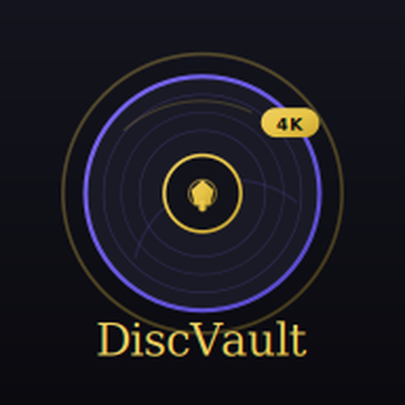
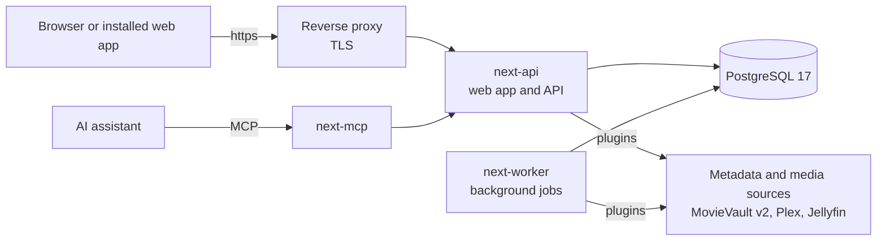

<div align="center">

<picture>
  <source media="(prefers-color-scheme: dark)" srcset="app/frontend/pwa-icon-512.png">
  
</picture>

# DiscVault

**A catalogue for the films you own on disc: 4K UHD, Blu-ray and DVD.**

Scan a barcode and DiscVault fills in the title, edition, format and artwork. Run it on your own
server and use it in the browser, or keep your collection on your iPhone, iPad or Android phone.

[](#getting-started)
[](#installation-self-hosted)
[](#features)

[](https://github.com/helmerzNL/DiscVault/commits/release/v26-beta)
[](https://github.com/helmerzNL/DiscVault/graphs/commit-activity)
[](LICENSE)
[](https://github.com/helmerzNL/DiscVault/forks)
[](https://github.com/helmerzNL/DiscVault/stargazers)
[](https://github.com/helmerzNL/DiscVault/issues)
[](https://github.com/helmerzNL/DiscVault/graphs/contributors)

[](https://github.com/helmerzNL/DiscVault/releases/latest)
[](https://discord.gg/zdc88VB8mJ)
[](https://buymeacoffee.com/flux76)
[](https://ko-fi.com/flux76)

[Website](https://discvault.eu) · [Documentation](https://docs.discvault.eu) · [Changelog](https://github.com/helmerzNL/DiscVault/releases) · [Report a bug](https://github.com/helmerzNL/DiscVault/issues/new/choose)

<picture>
  <source media="(prefers-color-scheme: dark)" srcset="screenshots/v26-desktop/DisccVault%2026%20-%2001%20-%20Library%20Posters.png">
  
</picture>

</div>

---

## Contents

- [Why DiscVault?](#why-discvault)
- [Features](#features)
- [Screenshots](#screenshots)
- [Getting started](#getting-started)
- [Configuration](#configuration)
- [Running it](#running-it)
- [Data and backups](#data-and-backups)
- [Architecture](#architecture)
- [Stable and beta](#stable-and-beta)
- [Contributing](#contributing)
- [Privacy and security](#privacy-and-security)
- [Support DiscVault](#support-discvault)
- [License](#license)

## Why DiscVault?

A disc collection outgrows memory and spreadsheets quickly: which edition is on the shelf, is the
4K inside that box set, did you already buy this one? Streaming apps only know what you stream,
and collection websites keep your list on their servers. DiscVault catalogues the films you own on
disc, edition by edition, and keeps that catalogue where you want it: on a server you run, or on
your own phone. No account with us, no analytics, no advertising and no trackers.

## Features

- **Your whole shelf at a glance**: browse posters, a list or detail cards, filter by format (4K UHD, Blu-ray, DVD), search by title, barcode, format or crew, and open box sets and containers to see what is inside.
- **Scan to add**: scan a barcode to fill in title, year, format and cover art, search by name, or enter a disc by hand.
- **Rich detail pages**: posters, backdrops, videos and metadata per film and per edition, Steelbooks and box sets included.
- **Metadata from plugins**: a plugin runtime for metadata sources, import sources and digital libraries, with MovieVault v2 as the first source. Plex and Jellyfin matching shows which discs you also own digitally.
- **Watchlist and watch history**: keep track of what you want to see and what you have seen.
- **Share it with your household**: users, invite-only registration, groups with invitations, roles and permissions, and a push notification when someone adds a disc to a shared group.
- **Sign in with a passkey**: passkeys first, with recovery; optionally a password with TOTP, or single sign-on through OpenID Connect.
- **Import and migrate**: bring a collection in from a file, or move an existing DiscVault Legacy installation across with a guided migration.
- **Ready for your AI assistant**: an MCP endpoint, and personal API keys that connect an assistant to your own collection only.
- **Your data, your server**: everything runs in your own containers, with backup and restore built in, 29 languages, and an installable web app that keeps working offline.

The full description of every feature is in the [documentation](https://docs.discvault.eu).

## Screenshots

| Library posters | Library list | Detail |
|:---:|:---:|:---:|
|  |  |  |

| Backdrops | Watchlist | Watched history |
|:---:|:---:|:---:|
|  |  |  |

| Roles and permissions | Plugins | Preferences |
|:---:|:---:|:---:|
|  |  |  |

<details>
<summary><strong>Migrating from DiscVault Legacy</strong></summary>

DiscVault 26 includes a guided migration for existing installations. The wizard checks your
current data, confirms what can be imported, runs the migration, and then opens the new app.

| Start migration | Authenticate with your passkey | Review the wizard | Confirm the scope |
|:---:|:---:|:---:|:---:|
|  |  |  |  |

| Ready to start | In progress | Finished | Start DiscVault 26 |
|:---:|:---:|:---:|:---:|
|  |  |  |  |

</details>

## Getting started

- 🌐 **Web:** open the address of your own installation, and [install it as an app](#install-as-an-app) if you like.
- 📱 **iPhone and iPad:** [download DiscVault on the App Store](https://apps.apple.com/app/discvault/id6788772918). It runs entirely on the device: scan, enrich, filter and search without a server. Prerelease builds are on the [TestFlight beta](https://testflight.apple.com/join/6bJetcyy).
- 🤖 **Android:** in beta. [Request access on Discord](https://discord.gg/zdc88VB8mJ); approved testers install through Google Play.
- 🐳 **Self-hosted:** see [Installation](#installation-self-hosted).

The iPhone, iPad and Android apps keep your collection on the device. Connecting them to a
self-hosted installation is planned for a later stage.

### Install as an app

- **Android and desktop (Chrome, Edge):** open the https address and choose *Install app*.
- **iPhone / iPad:** open the https address in **Safari → Share → Add to Home Screen**.

Once installed, the web app keeps working offline.

### Installation (self-hosted)

DiscVault 26 runs as a small Docker Compose stack with PostgreSQL 17. The quickest route uses the
Compose file and environment template from the beta branch:

```bash
install -d -m 0700 /opt/discvault-next && cd /opt/discvault-next
curl -fLO https://raw.githubusercontent.com/helmerzNL/DiscVault/release/v26-beta/app/deploy/next/docker-compose.yml
curl -fL -o .env https://raw.githubusercontent.com/helmerzNL/DiscVault/release/v26-beta/app/deploy/next/.env.example
# edit .env: DISCVAULT_NEXT_IMAGE=ghcr.io/helmerznl/discvault:beta (never the template's :dev),
# POSTGRES_PASSWORD, JWT_SECRET (openssl rand -base64 48), DISCVAULT_DATA_DIR and
# DISCVAULT_NEXT_POSTGRES_DATA (absolute host folders), RP_ID and RP_ORIGINS
docker compose -p discvault_next_deploy up -d
```

Then open `http://<host>:6180` and follow the first-run setup. The first start applies every
database migration and can take a couple of minutes. Passkeys need a secure context, so anything
other than `localhost` belongs behind a reverse proxy with HTTPS.

The stable channel (`:latest`), the equivalent `docker run` setup, reverse proxy and passkeys, and
storage are covered step by step in the [server guide](https://docs.discvault.eu/install/). The
stack itself, its preflight check and its troubleshooting are in
[`app/deploy/next/README.md`](app/deploy/next/README.md).

### Unraid

- Unraid template repository: <https://github.com/helmerzNL/unraid-templates>
- Support thread: <https://forums.unraid.net/topic/198808-support-discvault-physical-disc-collection-manager/>
- Guide: [Install on Unraid](https://docs.discvault.eu/install/unraid/)

## Configuration

Set in `.env`; [`app/deploy/next/.env.example`](app/deploy/next/.env.example) documents every
value, and the [environment reference](https://docs.discvault.eu/configure/environment/) explains
them at length. Never commit `.env`.

| Variable | Required | Default | Description |
|---|:---:|---|---|
| `DISCVAULT_NEXT_IMAGE` | ✅ | `:dev` in the template | Which build runs: `ghcr.io/helmerznl/discvault:latest` (stable), `:beta`, or a version such as `:v26.10.17`. Never the engineering `:dev` image |
| `DISCVAULT_DATA_DIR` | ✅ | - | Host folder mounted as `/data`: artwork, backups, plugins. An absolute path on a local disk (the template suggests `/mnt/user/appdata/discvault`) |
| `DISCVAULT_NEXT_POSTGRES_DATA` | ❌ | `./postgres-data` | Host folder for the PostgreSQL data. Set an absolute path on the same storage as `DISCVAULT_DATA_DIR`, so both are backed up together |
| `POSTGRES_PASSWORD` | ✅ | - | Database password. Applied only when the database is first created |
| `POSTGRES_DB`, `POSTGRES_USER` | ✅ | `discvault_next` | Database name and user. On an existing stack, `POSTGRES_DB` must match the database that already exists |
| `JWT_SECRET` | ✅ | - | Signs sessions and protects stored credentials. Generate it once with `openssl rand -base64 48` and never change it: DiscVault refuses to start without it, and a new value signs everyone out and disconnects integrations |
| `RP_ID` | ❌ | - | The hostname people open, without scheme or port, such as `discvault.example.com`; passkeys are bound to it. Leave it empty for a direct private or loopback IP |
| `RP_ORIGINS` | ❌ | - | Allowed origins, comma-separated, matching `RP_ID`, such as `https://discvault.example.com`. Put the canonical public origin first |
| `DISCVAULT_NEXT_API_PORT` | ❌ | `6180` | Host port for the web app and API. Unique per stack on one host |
| `DISCVAULT_NEXT_MCP_PORT` | ❌ | `6090` | Host port for the MCP server. Unique per stack on one host |
| `DISCVAULT_NEXT_NETWORK_NAME` | ❌ | `discvault-next` | Docker network name. Unique per stack, or two stacks reach each other's database |
| `DISCVAULT_TRUSTED_PROXIES` | ❌ | empty | Which hops may state a client address. Behind a reverse proxy on your own network: `private`, as the template sets it |
| `LEGACY_AUTH_ENABLED` | ❌ | `false` | Offers password + TOTP sign-in besides passkeys |
| `DISCVAULT_OIDC_*` | ❌ | empty | OpenID Connect sign-in: `_ISSUER`, `_CLIENT_ID` and `_CLIENT_SECRET` all three, or none. See [OIDC](https://docs.discvault.eu/configure/oidc/) |
| `DISCVAULT_BLOCK_CRAWLERS` | ❌ | `true` | Keeps the instance out of search engines and AI training corpora. See [Privacy and security](#privacy-and-security) |
| `DISCVAULT_ADMIN_DEDUP_EXECUTE_ENABLED` | ❌ | `false` | Safety gate for the destructive duplicate merge. Leave it off |

**Password and TOTP.** Passkeys remain the preferred sign-in. `LEGACY_AUTH_ENABLED=true` only
exposes password sign-in: on an existing installation an owner or admin must then turn it on in
**Users & roles** and confirm the warning with a fresh passkey. On a completely fresh installation
(no users or credentials), the setup wizard may instead create the first owner with a password of
15 or more characters and mandatory TOTP; that bootstrap is atomic and single-use. TOTP secrets and
recovery codes are never included in backups, so restored password users with MFA enrol TOTP again.

## Running it

From the folder that holds `docker-compose.yml` and `.env`:

| Task | Command |
|---|---|
| Start | `docker compose -p discvault_next_deploy up -d` |
| Stop | `docker compose -p discvault_next_deploy down` |
| Update | `docker compose -p discvault_next_deploy pull && docker compose -p discvault_next_deploy up -d` |
| Roll back | stop the stack, restore the backup taken before the update (the `DISCVAULT_DATA_DIR` folder and the PostgreSQL dump), set `DISCVAULT_NEXT_IMAGE` back to the previous version, then `docker compose -p discvault_next_deploy up -d`; step by step in [Rollback](https://docs.discvault.eu/update/rollback/) |
| Logs | `docker compose -p discvault_next_deploy logs -f next-api` (or `next-worker`, `postgres`) |

- **Health check:** `GET /api/next/health` answers `200` with `"status": "ok"` once the API reaches a fully migrated database, and `503` with `"status": "degraded"` while migrations are not ready.
- **Largest upload:** 60 MB, for artwork and your own images. Whatever runs in front of DiscVault (a reverse proxy, a CDN) must allow at least that much, and at least 500 MB on `/api/next/backup/validate` and `/api/next/backup/restore`, where a backup archive is sent. A refusal with no matching line in the DiscVault log came from something in front.
- **Update check:** DiscVault tells owners and admins when a newer version exists on the chosen channel (stable, beta, or auto); it never updates itself.

Before updating:

- Create a backup in the app, or stop the stack and copy the data folders (see [Data and backups](#data-and-backups)).
- Keep the same `DISCVAULT_DATA_DIR` and `DISCVAULT_NEXT_POSTGRES_DATA`, so artwork, uploads, users, passkeys and settings stay available.
- Read the [release notes](https://github.com/helmerzNL/DiscVault/releases), especially before moving between stable and beta.

### Troubleshooting

- [Library shows too few movies, or the app freezes](docs/troubleshooting/library-count-and-app-freeze.md): a library counter that stops short (for example `200 / 228`), or an app that becomes unresponsive after a few minutes or a PDF export.
- [Stack-level troubleshooting](app/deploy/next/README.md#troubleshooting): PostgreSQL health, the preflight check and log commands.
- [Troubleshooting on docs.discvault.eu](https://docs.discvault.eu/troubleshooting/) and the [FAQ](https://discvault.eu/faq).

## Data and backups

Everything DiscVault keeps lives in two host folders. `DISCVAULT_DATA_DIR`, mounted as `/data`:

| Folder | What is in it |
|---|---|
| `media/` | The artwork DiscVault stores: posters, backdrops, your own images, profile pictures, cached MovieVault posters |
| `backups/` | Backup archives created in the app (`DISCVAULT_NEXT_BACKUP_DIR` moves them elsewhere) |
| `plugins/` | Installed plugins (`DISCVAULT_PLUGIN_INSTALL_DIR` moves them elsewhere) |
| `discvault.db`, `posters/`, `profiles/`, `avatars/` | Only after a move from DiscVault Legacy: read by the migration and left in place |

and `DISCVAULT_NEXT_POSTGRES_DATA`, which holds the PostgreSQL database: the collection, users,
settings and jobs.

Back up from within the app (**Admin → Operations → Backup & restore**), or stop the stack and copy
both folders. A backup never contains passkeys, TOTP secrets, recovery codes, invite codes or
plugin secrets; user accounts are an optional part of it. Restoring: choose the backup ZIP under
**Backup & restore** in the app, or restore a full copy of both folders as described in
[Backup](https://docs.discvault.eu/update/backup/) and
[Restore](https://docs.discvault.eu/update/restore/).

## Architecture



| Component | Purpose | Data |
|---|---|---|
| `postgres` | PostgreSQL 17: the collection, users, settings and the job queue | `DISCVAULT_NEXT_POSTGRES_DATA` |
| `next-api` | The web app and the API (Flask + Gunicorn on container port 5000); applies pending migrations on start and serves `/mcp` as a proxy | `DISCVAULT_DATA_DIR` → `/data` |
| `next-worker` | Background jobs: metadata, imports, synchronization, plugin jobs | `DISCVAULT_DATA_DIR` → `/data` |
| `next-mcp` | The MCP server for AI assistants, on port 6090; it calls the API | - |

Plugins are loaded from manifest folders: the bundled ones from the image, installed ones from
`/data/plugins`. The highest-priority metadata source is the standalone MovieVault v2 plugin, which
works through an anonymous bridge in DiscVault itself:
[`docs/movievault-v2-plugin.md`](docs/movievault-v2-plugin.md).

DiscVault Core in this repository is the server, the web app, the MCP server and the plugin
runtime. The iPhone, iPad and Android apps are separate apps, and the marketing website
<https://discvault.eu> lives in its own repository. Developing and running from source:
[`app/README.md`](app/README.md).

## Stable and beta

| | Stable | Beta |
|---|---|---|
| Branch | `main` | `release/v26-beta` |
| Image | `ghcr.io/helmerznl/discvault:latest` (also `:stable`, `:v26`, and `:v26.X.Y` per release) | `ghcr.io/helmerznl/discvault:beta` (also `:v26-beta`) |
| GitHub release | `v26.X.Y` | none: every merge builds a new image |

Every change lands in `release/v26-beta` first, and reaches `main` through a deliberate
promotion. To try the beta, use the `:beta` image with its own data folders, and create a backup
before moving an existing library between stable and beta. Image references are lowercase: GitHub
shows the repository as `helmerzNL/DiscVault`, but Docker pulls `ghcr.io/helmerznl/discvault`.
The branch and image model in full: [`docs/BRANCHING.md`](docs/BRANCHING.md).

## Contributing

Contributions are welcome. Pull requests go to the `release/v26-beta` branch, never to `main`. The
working conventions for people and AI assistants alike are in [`AGENTS.md`](AGENTS.md). For bugs
and ideas, open an [issue](https://github.com/helmerzNL/DiscVault/issues/new/choose); for questions,
use [Discussions](https://github.com/helmerzNL/DiscVault/discussions).

```bash
git config core.hooksPath .githooks
cd app && cp .env.example .env   # set JWT_SECRET, RP_ID and RP_ORIGIN
docker compose -f docker-compose.next.yml up -d --build
cd backend && python -m unittest discover -s tests -t . -p "test_*.py"
```

## Privacy and security

- Everything is stored on your own server, or on your own device: no account with us, no analytics, no advertising, no tracking.
- Metadata lookups go to the metadata plugins that are enabled. MovieVault v2, on by default, is reached through an anonymous bridge in DiscVault itself; contributing corrections back to MovieVault is a separate setting that only the owner can change.
- An instance keeps itself out of search engines and AI training corpora without any configuration: `/robots.txt` disallows every crawler, every response carries `X-Robots-Tag: noindex`, and known crawlers are refused. A reverse proxy in front must pass this through. This is not a security control: an instance that must not be reachable belongs behind authentication, a VPN, or off the public internet. The details: [`docs/search-engines-and-ai-crawlers.md`](docs/search-engines-and-ai-crawlers.md).
- Report a vulnerability privately, as described in [`SECURITY.md`](.github/SECURITY.md), never in a public issue.

## Support DiscVault

DiscVault is free. If it is useful to you, a coffee keeps the development going.

<a href="https://buymeacoffee.com/flux76"></a>
<a href="https://ko-fi.com/flux76"></a>

## License

[MIT](LICENSE) © 2026 Helmer Zandbergen

---

<div align="center">
<sub>Made with ❤️ in the Netherlands by <a href="https://flux76.com">Flux76</a></sub>
</div>
